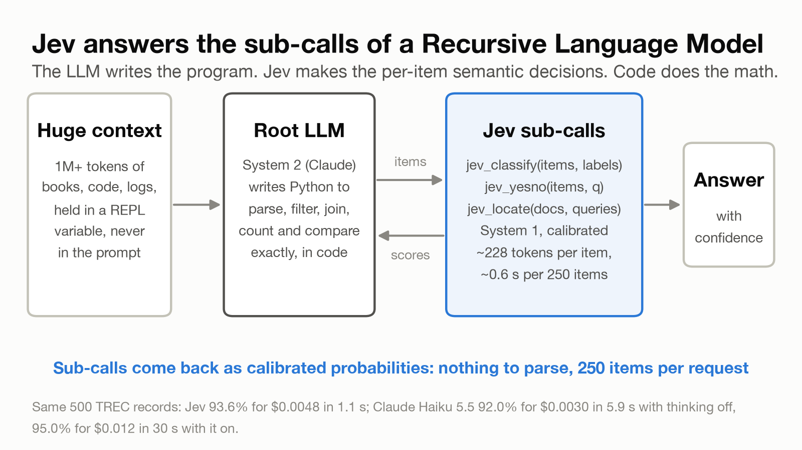

<div align="center">

# rlm-jev

**Calibrated sub-calls for Recursive Language Models, backed by TypeSafe's [Jev](https://docs.typesafe.ai).**

`classify`, `yesno` and `locate` return probabilities instead of text, and plug into `dspy.RLM`,
[alexzhang13/rlm](https://github.com/alexzhang13/rlm) or your own REPL loop.

**[Write-up](https://www.jordanhochenbaum.com/blog/jev-rlm-sub-calls/)** &middot;
**[RLM paper](https://arxiv.org/abs/2512.24601)** &middot;
**[Reproducing](REPRODUCE.md)** &middot;
**[Results](results/summary.json)**

[](https://github.com/jhochenbaum/rlm-jev/actions/workflows/ci.yml)
[](LICENSE)
[](pyproject.toml)



</div>

---

> [!NOTE]
> This is the companion code to [the write-up](https://www.jordanhochenbaum.com/blog/jev-rlm-sub-calls/): an
> exploration of System One models as RLM sub-calls, not a production library. `rlm_jev/` is small and tested, and
> fine to build on. `experiments/` and `jevlab/` are research code, kept so that every number in the write-up can be
> reproduced. The results come from small samples and single runs, and the API may change.

**Contents:** [Overview](#overview) &middot; [Install](#install) &middot; [Use it in an RLM](#use-it-in-an-rlm)
&middot; [Use the sub-calls directly](#use-the-sub-calls-directly) &middot; [Three rules](#three-rules)
&middot; [Results](#results) &middot; [Layout](#layout)

## Overview

A [Recursive Language Model](https://arxiv.org/abs/2512.24601) (Zhang, Kraska and Khattab) keeps a huge input in a
Python variable and lets a root LLM write code over it. Most of the sub-calls that code makes are decisions: is this
line relevant, which category is this question. These tools answer them with a model that returns calibrated
probabilities, so the root gets numbers it can compute with instead of text it has to parse.

## Install

```bash
uv add "rlm-jev @ git+https://github.com/jhochenbaum/rlm-jev"
export TYPESAFE_API_KEY=...
```

| Extra | Adds | Install |
|---|---|---|
| `dspy` | `dspy.RLM` integration (`NoteRLM`) | `uv add "rlm-jev[dspy] @ git+https://github.com/jhochenbaum/rlm-jev"` |
| `rlm` | [alexzhang13/rlm](https://github.com/alexzhang13/rlm) integration | `uv add "rlm-jev[rlm] @ git+https://github.com/jhochenbaum/rlm-jev"` |

With pip: `pip install "rlm-jev @ git+https://github.com/jhochenbaum/rlm-jev"`.

## Use it in an RLM

Either way, the root gets four tools, with docstrings written for it:

| Tool | Returns |
|---|---|
| `jev_classify(items, labels)` | one `{label: p}` per item |
| `jev_yesno(items, question)` | one P(yes) per item |
| `jev_locate(docs, queries)` | the top passages per query, with offsets |
| `jev_spend()` | Jev requests, tokens and dollars so far |

`max_usd` caps Jev spend for the tool set. Runnable versions are in [`examples/`](examples/).

### With `dspy.RLM`

Its sandbox needs [Deno](https://deno.land).

```python
import dspy
from rlm_jev import rlm_tools
from rlm_jev.dspy_rlm import NoteRLM

dspy.configure(lm=dspy.LM("anthropic/claude-sonnet-5-5"))
rlm = NoteRLM("context, query -> answer", tools=rlm_tools(max_usd=0.50))
rlm(context=huge_text, query="Which user posted the most spam?").answer
```

> [!TIP]
> `NoteRLM` is `dspy.RLM` with one change. Stock `dspy.RLM` asks the root for a step-by-step `reasoning` field, which
> Claude Sonnet 5.5 refuses (`reasoning_extraction`, see
> [stanfordnlp/dspy#10641](https://github.com/stanfordnlp/dspy/issues/10641)), so `NoteRLM` asks for a one-sentence
> note instead. DSPy has merged a fix ([stanfordnlp/dspy#10643](https://github.com/stanfordnlp/dspy/pull/10643)); once
> it ships, plain `dspy.RLM` works on Claude 5 models too, and it already works with other models. Both take the same
> `tools=` argument.

### With [alexzhang13/rlm](https://github.com/alexzhang13/rlm)

```python
import os
from rlm import RLM
from rlm_jev import rlm_tools

rlm = RLM(
    backend="anthropic",
    backend_kwargs={"model_name": "claude-sonnet-5-5", "api_key": os.environ["ANTHROPIC_API_KEY"]},
    custom_tools=rlm_tools(max_usd=0.50, style="rlm"),
)
rlm.completion(huge_text, root_prompt="Which user posted the most spam?").response
```

## Use the sub-calls directly

```python
from rlm_jev import classify, yesno, locate, fit_weights, apply_weights, mc_confidence, stats

probs = classify(reviews, {"positive": None, "negative": None}, ensemble=True)  # [{label: p}, ...]
p_yes = yesno(tickets, "Does the customer ask for a refund?")  # [p, ...]
hits = locate(book_text, ["Who does Holmes call 'the woman'?"], k=3)  # {query: [{doc, offset, score, text}, ...]}
w = fit_weights(probs[:300], gold[:300])  # per-label weights, fit on your data
labels = apply_weights(probs, w)
answer, confidence = mc_confidence(lambda labs: labs.count("negative") > labs.count("positive"), probs)
stats()  # requests, tokens, $
```

## Three rules

These come from the experiments, and the library follows them.

1. **Never make Jev find an item by position.** Asking about `records[17]` in an unlabeled list dropped accuracy from
   94% to 34% at 100 items per request. Putting each item inside its own question (what these tools do), or giving
   each item a visible ID in the state, held 95–96% at 250 items per request, for about half the tokens of one
   request per item.
2. **Let many questions share one state.** `locate()` sends each window of a corpus once with every query attached,
   so 30 queries over 1.2M tokens cost one read (about $0.004 per query).
3. **Label descriptions go in every question by default.** `classify(..., labels_in_state=True)` writes them once in
   the shared state instead: 89 tokens per item instead of 228 and the same calibration, but on 4,151 TREC records
   about 1.5 points lower accuracy and more biased counts. Fitted label weights (`fit_weights`) correct that bias
   well.

## Results

Small samples; the write-up has the caveats. Root: Claude Sonnet 5.5. LLM sub-call baseline: Claude Haiku 5.5 through
the Claude Code CLI, with its default extended thinking (the thinking-off comparison used the API). Every number is in
[`results/summary.json`](results/summary.json).

| Experiment | Result |
|---|---|
| **Sub-call swap**, same 500 records | Jev 93.6% ($0.0048, 1.1 s) · labels in shared state 92.8% ($0.0019) · Haiku 5.5: 92.0% thinking off ($0.0030, 5.9 s), 95.0% thinking on ($0.012, 30 s) |
| **OOLONG @32k**, 20 questions | Sonnet reading everything 0.76 ($0.17/q) · Haiku sub-calls 0.72 ($0.073/q, 57 s) · Jev sub-calls 0.68 ($0.071/q, 34 s) |
| **OOLONG @131k / 1M / 4M** | Jev RLM 0.66 / 0.70 / 0.67 (n = 20 / 20 / 3) · Haiku-sub-call RLM 0.62 / 0.75 (n = 20) · reading everything: Sonnet 0.53 / 0.40 truncated, Haiku 0.05 / 0.10 truncated (1M contexts are ~1.12M tokens) |
| **OOLONG-Pairs** | F1 0.77 (live root, n = 4); 0.85 / 0.89 (fixed program, 32k / 131k) |
| **30 hidden facts in 1.2M tokens** | `locate` R@5 100% (no index, ~$0.004/query across 30 queries, ~$0.05 alone) · Qwen3 embedding + reranker: 8B 97%, 4B 93%, 0.6B 80% |
| **InfiniteBench En.MC**, Haiku 5.5 answering | from Jev's ~8k words vs the whole book: 90% vs 80% (55k–103k words); 5/5 vs 3/5 (265k–352k words); 3/3 vs 2/3 truncated to fit (one 560k-word book) |
| **BrowseComp-Plus**, 1K docs (~8M tokens/q), 20 questions | 18/20 with Jev tools (30 turns) · 18/20 with regex only, 7× faster · closed-book 2/20 |
| **dspy.RLM vs minimal harness**, same questions | 0.71 vs 0.68 (131k), 0.50 vs 0.50 (1M), 0.73 vs 0.77 (Pairs F1), with `NoteRLM` on dspy 3.4.1 |
| **Abstaining** on the least confident 20% (fixed program) | OOLONG score 0.79 → 0.92 |
| **Escalating** uncertain items to Haiku 5.5 (best threshold, chosen on the same items) | MultiNLI 91.5% (Jev 89.7%, Haiku 90.2%) · negation 95.0% (Jev 87.9%, Haiku 92.6%) |

To rebuild every number and figure from the committed results, or rerun the experiments, see
[REPRODUCE.md](REPRODUCE.md).

## Layout

```
rlm_jev/        the library (core depends only on typesafe-sdk; dspy_rlm.py needs the dspy extra)
examples/       dspy.RLM and alexzhang13/rlm examples
tests/          offline tests for the library (fake Jev client; run by CI)
experiments/    every experiment in the write-up (see REPRODUCE.md)
jevlab/         experiment internals: budget-capped client, label cache, minimal RLM harness, benchmark programs
results/        raw results and summary.json
figures/        the write-up's figures and the script that rebuilds them from results/summary.json
bin/jev         command-line tool over files too big to read (runs jevlab.cli in the repo's environment)
```

## License

[MIT](LICENSE)
